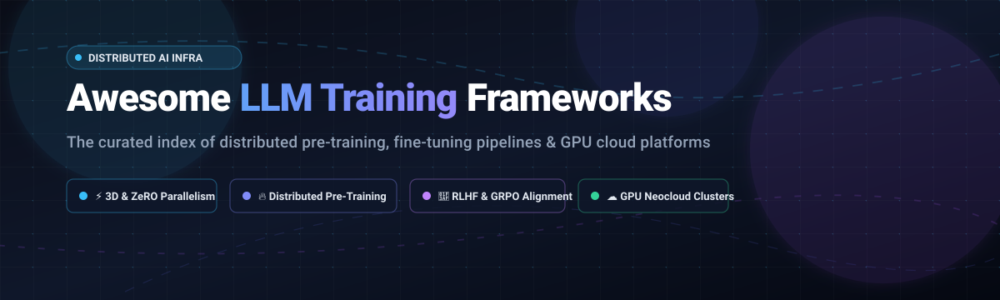
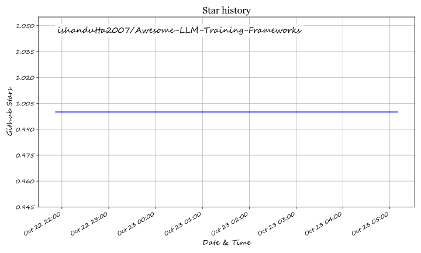

  

# 🚀 Awesome-LLM-Training-Frameworks

  
  
  
  
  
  
  

> ⚡ **A curated list of state-of-the-art LLM Training Frameworks, Distributed Pre-Training Engines, Parameter-Efficient Fine-Tuning (PEFT/LoRA) Pipelines, Reinforcement Learning (RLHF/GRPO/DPO) Alignment Toolkits, and High-Performance GPU Cloud Infrastructure.**

---

## 🧭 Table of Contents

- [🌐 Sector Overview & Market Dynamics](#-sector-overview--market-dynamics)
- [☁️ SaaS / Hosted GPU Cloud Platforms](#️-saas--hosted-gpu-cloud-platforms)
- [📦 Open-Source GitHub Projects](#-open-source-github-projects)
  - [Top Frameworks Ranked by GitHub_Stars](#top-frameworks-ranked-by-github-stars)
  - [Framework Selection Guide](#framework-selection-guide)
- [🤝 How to Contribute](#-how-to-contribute)
- [⭐ Star History](#-star-history)
- [💖 Support & Sponsorship](#-support--sponsorship)
- [📄 Disclaimer](#-disclaimer)

---

## 🌐 Sector Overview & Market Dynamics

The global AI training infrastructure and GPU cloud computing market is estimated at approximately **$100B–$120B in 2026**, scaling rapidly at a **~15%–17% CAGR** driven by frontier foundation model pre-training and domain-specific fine-tuning demands. 

Market dynamics exhibit a bifurcated structure:
* **Hardware & Hyperscaler Core (Highly Concentrated):** Foundational silicon and massive multi-gigawatt compute are consolidated around **NVIDIA** (commanding 75%+ GPU market share) and top hyperscalers (Microsoft Azure, AWS, Google Cloud).
* **Neocloud & Software Orchestration (Moderately Fragmented):** The secondary compute and software stack is intensely competitive and fragmented, as specialized alternative "neoclouds" compete on raw unit economics, instant InfiniBand clusters, zero egress fees, and developer-first multi-node orchestration.

---

## ☁️ SaaS / Hosted GPU Cloud Platforms

| Platform | Company Scale (Valuation / Revenue) | Starting Pricing Tier | Free Tier Limits / Free Trial | Description & Key Workloads |
| :--- | :--- | :--- | :--- | :--- |
| **[CoreWeave](https://www.coreweave.com/)** | ~$35B–$55B Valuation / ~$7.6B TTM Revenue | Starts at $2.00–$2.50/GPU-hr (PCIe cards); 8x H100 SXM nodes start at $49.24/hr ($6.16/GPU-hr); 8x B200 at $68.80/hr | No automatic free tier; 14-day evaluation trial with $25–$100 testing credits granted via CoreWeave ARENA application or sales outreach | NVIDIA-specialized AI hyperscaler built for massive multi-node training clusters. Rents H100/H200/B200 in full 8-GPU nodes; up to 60% discounts for reserved multi-year commitments. |
| **[Nebius AI](https://nebius.com/)** | ~$43B–$46B Market Cap (NASDAQ: NBIS) / ~$3.0B ARR | Starts at $0.74/GPU-hr (Spot/Preemptible L40S); On-demand starts at $1.55/GPU-hr (L40S) and $4.50/GPU-hr (H100 NVLink) | Free tier trial suspended for core GPU VMs; $1 credit included on signup for Token Factory API/Studio model playground | Amsterdam-headquartered European full-stack AI cloud provider with transparent published rates, InfiniBand interconnects, and strict EU data residency guarantees. |
| **[Crusoe Cloud](https://www.crusoe.ai/)** | ~$30.9B Valuation / ~$140B Contracted Backlog | Starts at $1.50/GPU-hr (NVIDIA L40S); NVIDIA H100 80GB SXM starts at $3.90/GPU-hr; H200 at $4.29/GPU-hr | $5 free trial credit provided on initial account signup (covers serverless inference and serverless fine-tuning exploratory runs) | Climate-aligned, energy-integrated compute cloud offering spot, on-demand, and reserved GPU clusters with zero egress fees and flexible contract terms. |
| **[Lambda](https://lambda.ai/)** | ~$12.0B Valuation / ~$1.5B Revenue Run-Rate | Starts at $1.29/GPU-hr (NVIDIA A10); 1x H100 SXM at $4.29/GPU-hr; 8x H100 SXM at $3.99/GPU-hr | No free tier or automated trial credits; academic research teams can apply for the Lambda Research Grant offering up to $5,000 in GPU cloud credits | AI-first GPU cloud with first-party datacenters, standard per-GPU pricing, and 1-Click Clusters with InfiniBand for multi-node distributed training runs. |
| **[Together AI](https://www.together.ai/)** | ~$8.3B Valuation / ~$500M+ Revenue Run-Rate | Dedicated endpoints start at $5.49/GPU-hr (H100); Raw GPU training clusters start at $3.09/GPU-hr (Reserved H100) or $3.99/GPU-hr (On-demand) | No automated free trial on signup (requires initial $15 minimum credit deposit); startup accelerator grants $15,000 to $50,000 in credits upon application | End-to-end platform spanning serverless endpoints, fine-tuning workflows, and dedicated raw GPU clusters for distributed foundation model training. |
| **[RunPod](https://www.runpod.io/)** | ~$1.0B Valuation / ~$120M ARR | Community Cloud starts at $0.20/GPU-hr; Secure Cloud starts at $0.27/GPU-hr; H100 SXM starts at $2.99–$3.99/GPU-hr | $10 exploratory credit on new signup / referral link for testing serverless and pods; up to $1,000 via self-serve Startup Program | Developer-friendly cloud featuring per-second billing, serverless GPU workers, and instant pods for experimentation, fine-tuning, and light training runs. |

---

## 📦 Open-Source GitHub Projects

### Top Frameworks Ranked by GitHub_Stars

- **[Unsloth](https://github.com/unslothai/unsloth)**   
  ⚡ **5x faster, 80% less memory fine-tuning.** Hand-crafted manual backpropagation and Triton GPU kernels for LLaMA, Mistral, Gemma, DeepSeek, and Qwen. Supports QLoRA, LoRA, and full fine-tuning with zero accuracy degradation on single or multi-GPU environments.

- **[LLaMA-Factory](https://github.com/hiyouga/LLaMA-Factory)**   
  🎛️ **The unified fine-tuning and alignment framework.** Supports 100+ LLMs and VLMs (LLaMA, Qwen, Mistral, DeepSeek) with pre-training, SFT, reward modeling, PPO, DPO, KTO, and ORPO. Features an intuitive web UI (LLaMA Board) for zero-code orchestration and DeepSpeed/FSDP acceleration.

- **[DeepSpeed](https://github.com/deepspeedai/DeepSpeed)**   
  🚀 **Microsoft's ZeRO distributed training standard.** Pioneer of ZeRO (Zero Redundancy Optimizer Stages 1/2/3 and ZeRO-Offload), eliminating memory redundancy across GPU nodes. Powers frontier pre-training loops and serves as the backend engine for Hugging Face Accelerate, Megatron-DeepSpeed, and EleutherAI tools.

- **[Colossal-AI](https://github.com/hpcaitech/ColossalAI)**   
  🌐 **Unified multi-dimensional parallelism framework.** Implements tensor, pipeline, sequence, and zero memory parallelism with NVMe offload. Delivers 24x larger model scaling on identical hardware and demonstrated 195% speedups on 70B LLaMA distributed training runs.

- **[VeRL (HybridFlow)](https://github.com/volcengine/verl)**   
  🎯 **Post-training RL framework for reasoning & alignment.** Volcano Engine's flexible infrastructure designed for RL algorithms (PPO, GRPO) scaling up to 70B models on hundreds of GPUs. Decouples generation rollouts from training actors via high-throughput 3D hybrid scheduling.

- **[TRL (Transformer Reinforcement Learning)](https://github.com/huggingface/trl)**   
  🤗 **Hugging Face's standard alignment library.** Provides out-of-the-box tools for SFT, Reward Modeling, DPO, PPO, and GRPO. Integrates seamlessly with `transformers`, `datasets`, and `peft` for direct post-training and reasoning-model workflows.

- **[Megatron-LM](https://github.com/NVIDIA/Megatron-LM)**   
  💎 **NVIDIA's peak-performance training engine.** The gold reference for frontier transformer pre-training with optimized Tensor Parallelism (TP), Pipeline Parallelism (PP), Context Parallelism (CP), and Expert Parallelism (EP). Achieves up to **47% Model FLOP Utilization (MFU)** on thousands of H100 GPUs with FP8 Transformer Engine support.

- **[LitGPT](https://github.com/Lightning-AI/litgpt)**   
  ⚡ **Hackable, dependency-clean LLM pre-training and fine-tuning.** Lightning AI's production implementation supporting 20+ architectures with pure PyTorch, FlashAttention, FSDP, LoRA, and automated benchmarking without nested abstraction layers.

- **[Axolotl](https://github.com/axolotl-ai-cloud/axolotl)**   
  📜 **The YAML-driven production fine-tuning framework.** Configuration-as-artifact for complete training reproducibility. Built on DeepSpeed and PyTorch FSDP, with native support for LoRA/QLoRA, DPO, GRPO, and multi-node cluster execution.

- **[Oumi](https://github.com/oumi-ai/oumi)**   
  🔄 **The full-lifecycle open platform.** Comprehensive open toolkit covering dataset preparation, pre-training, SFT/DPO alignment, evaluation, and deployment with 200+ battle-tested recipes for models from LLaMA to DeepSeek-R1.

- **[GPT-NeoX](https://github.com/EleutherAI/gpt-neox)**   
  🧪 **EleutherAI's research-grade training library.** Built on DeeperSpeed with 3D parallelism and Flash Attention. The proven open codebase behind the training of GPT-NeoX-20B and Pythia models.

- **[TorchTitan](https://github.com/pytorch/torchtitan)**   
  🔥 **PyTorch native clean-slate distributed training.** The PyTorch team's flagship proof-of-concept for training 3D parallel LLMs using native PyTorch components (FSDP2, Tensor Parallel, Pipeline Parallel, and Float8).

- **[LLM Foundry](https://github.com/mosaicml/llm-foundry)**   
  🏭 **MosaicML / Databricks enterprise training stack.** Modular framework for end-to-end distributed pre-training and fine-tuning with streaming datasets, FSDP optimization, and Composer integration.

- **[InternEvo](https://github.com/InternLM/InternEvo)**   
  🛡️ **Ultra-scale distributed training for thousands of GPUs.** Highly optimized 7D parallelism framework powering the InternLM series, featuring zero-overhead checkpointing and scaling efficiency over 10,000 accelerators.

- **[FlagScale](https://github.com/FlagOpen/FlagScale)**   
  🎏 **Cross-chip distributed training system.** BAAI's open framework designed for multi-architecture clusters (NVIDIA, AMD, Ascend, Cambricon) with unified communication and automated parallel strategy search.

---

### 💡 Framework Selection Guide

| Use Case | Recommended Framework | Why |
| :--- | :--- | :--- |
| **Frontier Pre-Training (NVIDIA)** | **Megatron-LM** | Maximum MFU (up to 47%), FP8 Transformer Engine, battle-tested at 1,000+ GPUs. |
| **Rapid PEFT / Single-GPU LoRA** | **Unsloth** | 5x faster, 80% memory reduction, custom Triton backward pass. |
| **All-in-One Fine-Tuning WebUI** | **LLaMA-Factory** | Multi-model coverage, SFT/DPO/ORPO support, user-friendly dashboard. |
| **Production YAML Fine-Tuning** | **Axolotl** | Declarative configuration files, repeatable experiments, strong FSDP integration. |
| **Post-Training RL / GRPO** | **VeRL** or **TRL** | Decoupled rollout and training actors for deep reasoning and alignment loops. |
| **Pure Native PyTorch 3D** | **TorchTitan** | Clean reference design using FSDP2 and native PyTorch 2.x primitives. |

---

## 🤝 How to Contribute

Contributions are warmly welcomed! Help keep this ecosystem index fresh and accurate:

1. 🍴 **Fork the repository**.
2. 🌿 **Create a descriptive branch** (`git checkout -b add-new-framework`).
3. 📝 **Add or update entries** in `README.md` (keep descriptions factual, include links and accurate specs).
4. 📬 **Submit a Pull Request** with a brief summary of the addition.

---

## ⭐ Star History

---

## 💖 Support & Sponsorship

If this curated repository helped you find the right training engine, fine-tuning framework, or cloud infrastructure:

- ⭐ **Star this repository** to support our open-source curation!
- 🍴 **Fork & Share** with your colleagues and ML engineering communities.
- ☕ **Support the maintainer**: Buy a coffee or become a sponsor at the **[Sponsor Dashboard](https://github.com/sponsors/ishandutta2007)**.

Thank you to all contributors and community members! 🚀

---

## 📄 Disclaimer

- This is a **community-curated index** — not exhaustive and not a commercial endorsement.
- **Expertise Requirements**: Pre-training engines like Megatron-LM and InternEvo require deep distributed systems engineering; fine-tuning toolkits like Unsloth and LLaMA-Factory cater to fast practical deployment.
- **Node Minimums**: High-end GPU cloud instances (such as H100/B200 on CoreWeave) often mandate 8-GPU node minimum rentals.
- **Benchmark Specifics**: Performance utilization rates (e.g., MFU) depend heavily on cluster networking, batch sizes, sequence lengths, and hardware topology.

## ⭐ Star History

<a href="https://star-history.com/#ishandutta2007/Awesome-LLM-Training-Frameworks&Timeline" align="center">
  <picture>
    <source media="(prefers-color-scheme: dark)" srcset="assets/ishandutta2007_Awesome-LLM-Training-Frameworks_growth.svg">
    
  </picture>
</a>
